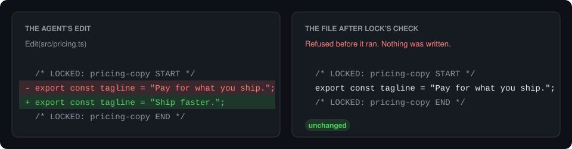

# lock

[](https://github.com/dariodaddamio/lock/actions/workflows/ci.yml)
[](https://dariodaddamio.github.io/lock/)
[](https://github.com/dariodaddamio/lock/releases/latest)
[](https://crates.io/crates/lock-hook)
[](LICENSE)

`lock` prevents coding agents from being able to change parts of your repo that
must not be changed. Full documentation is on
[GitHub Pages](https://dariodaddamio.github.io/lock/).



Some parts of a project are settled, such as the copy on a landing page, a
released changelog entry, or the timing of an animation. A coding agent cannot
tell which parts those are, so it improves whatever looks improvable, and a rule in
`AGENTS.md` does not stop it, because an agent can forget a rule in a long session.
With `lock`, you mark the settled parts once, and from then on an agent cannot
change them unless you approve the exact change.

## Quick start

Install `lock` on macOS, on Linux, or in Git Bash on Windows:

```sh
curl -fsSL https://raw.githubusercontent.com/dariodaddamio/lock/main/install.sh | sh
```

Or in PowerShell on Windows:

```powershell
irm https://raw.githubusercontent.com/dariodaddamio/lock/main/install.ps1 | iex
```

With Rust, `cargo install lock-hook` installs the same `lock` command.

Then run this in the root of your repository, and commit the files that it adds:

```sh
lock install
```

That is all the setup. Now tell your agent what to lock, for example "Lock the
pricing tagline." The agent puts two comment lines around the text, and from then
on `lock` refuses every change to that text that you have not approved.

Each agent asks you once before it runs hooks from a repository. Claude Code asks
whether you trust the folder, Codex asks you to trust the folder and then to review
the new hooks, and Cursor reads `.cursor/hooks.json` when it opens the project. An
agent finds `lock` on the PATH that it had when it started, so restart an agent
that was already running when you installed `lock`. Codex keeps a background
server, which `codex app-server daemon restart` restarts. Codex also stops running
a hook that changed until you review it again, so after `lock install` updates the
hooks, open `/hooks` in Codex and trust them.

`lock install` ends with these steps for your agents. Run `lock doctor` afterwards to
check them: it prints a PASS, WARN, or FAIL line for each part of the setup and says how
to fix it. A missing hook file for an agent that you use is a FAIL. If the hook files are in `.gitignore`, `lock install` and `lock doctor`
warn you, because teammates do not get files that git ignores.

## Documentation

- [Using lock](https://dariodaddamio.github.io/lock/using/) — day-to-day decisions and approvals.
- [How it works](https://dariodaddamio.github.io/lock/how-it-works/) — the five check points.
- [Limits](https://dariodaddamio.github.io/lock/limits/) — what lock does and does not stop.
- [Commands](https://dariodaddamio.github.io/lock/commands/) — CLI reference.
- [Lock markers](https://dariodaddamio.github.io/lock/markers/) — marker syntax and supported file types.
- [Team setup](https://dariodaddamio.github.io/lock/team/) — protect a shared repository and its approvals.
- [Questions](https://dariodaddamio.github.io/lock/faq/) — answers to common lock questions.

## Contributing

Bug reports, ideas, and pull requests are welcome. [CONTRIBUTING.md](CONTRIBUTING.md)
explains how to build and check `lock`, and [SECURITY.md](SECURITY.md) explains
how to report a way around it.

## License

[MIT](LICENSE)
