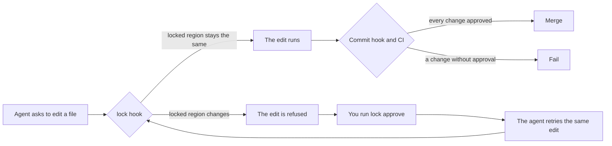

# lock

[](https://github.com/dariodaddamio/lock/actions/workflows/ci.yml)
[](LICENSE)

`lock` prevents coding agents from being able to change parts of your repo that
must not be changed.

When you settle on the copy for a landing page, a released changelog entry, or the
timing of an animation, you want it to stay that way. A coding agent does not know
that you made that decision. It improves whatever looks improvable, and a rule in
`AGENTS.md` is easy for it to forget in a long session. `lock` puts the decision in
the repository itself. You put `LOCKED` comments around the region, and from then
on the agent's edit is refused before it touches the file, until you approve that
exact change.

```text
> Change the tagline to "Ship faster."

● Edit(src/pricing.ts)
  ⎿  Blocked by hook: lock: src/pricing.ts has locked regions that this tool call
     would change or remove: `pricing-copy`. Nothing was written. If this change
     is wanted, ask the user to run `lock approve pricing-copy` in their own
     terminal, then retry the same edit.

● The tagline is locked, so I did not change it. If you want this change, run
  `lock approve pricing-copy` in your terminal, and I will retry the edit.
```

## At a glance

| | |
| --- | --- |
| Agents | Claude Code, Codex, and Cursor block the edit as it happens. Other agents are caught at commit time and in CI. |
| Platforms | macOS (Apple silicon and Intel), Linux (x64 and ARM64), and Windows (x64 and ARM64) |
| File types | Most code, style, markup, and config files, listed below. Any other file can be locked as a whole. |
| Install | One command. `lock` is a single binary with no runtime, and it needs only git. |
| Speed | About 50 ms for each check, so the agent does not slow down. |

### Supported file types

| File types | Write the markers as |
| --- | --- |
| JavaScript, TypeScript, JSX, TSX, CSS, SCSS, Less | `/* */`, `//`, or `{/* */}` in JSX |
| Rust, Go, Java, Kotlin, Swift, C, C++, C#, PHP, Scala, Dart, Zig | `/* */` or `//` |
| Markdown, MDX, HTML, SVG, XML | `<!-- -->` |
| Vue, Svelte, Astro | Any of the above |
| Python, Ruby, shell, PowerShell, YAML, TOML, Terraform, Nix | `#` |
| SQL, Lua, Haskell, Elm | `--` |
| Any other file, such as JSON or an image | A whole-file lock in `.locks/files.json` |

## Install

Install the binary with one command.

On macOS and Linux, and in Git Bash on Windows:

```sh
curl -fsSL https://raw.githubusercontent.com/dariodaddamio/lock/main/install.sh | sh
```

On Windows, in PowerShell:

```powershell
irm https://raw.githubusercontent.com/dariodaddamio/lock/main/install.ps1 | iex
```

Then, in the root of each repository that you want to protect, run:

```sh
lock install
```

That is all the setup a single developer needs. If you prefer to build from
source, run `cargo install --git https://github.com/dariodaddamio/lock --locked`,
or download an archive from the
[releases page](https://github.com/dariodaddamio/lock/releases).

`lock install` adds the hook to each agent and to git. Run it again at any time;
it does not add a hook twice.

| File | What `lock install` adds |
| --- | --- |
| `.claude/settings.json` | A `PreToolUse` hook that checks each Claude Code edit and shell command |
| `.codex/hooks.json` | The same hook for Codex |
| `.cursor/hooks.json` | The same hook for Cursor |
| `.git/hooks/pre-commit` | `lock check --staged`, which stops a commit that changes a lock without approval |

Commit the three agent files, so that every clone of the repository gets the
hook. The git hook is not committed, so each clone runs `lock install` once. In a
JavaScript project, a `"prepare": "lock install"` script in `package.json` does
this on every `npm install`, on any machine that has `lock` installed.

## Lock a region

Put a `START` marker on the line before the region and an `END` marker on the
line after it:

```ts
/* LOCKED: pricing-copy START - approved by design on 2026-10-30 */
export const tagline = "Pay for what you ship.";
/* LOCKED: pricing-copy END */
```

```md
<!-- LOCKED: release-history START -->
## 1.0.0 - October 30, 2026
<!-- LOCKED: release-history END -->
```

A few rules keep the markers unambiguous:

- Each marker is a comment at the start of its own line.
- The id uses lowercase letters, digits, and hyphens, and it is unique in its file.
- Text after `START` or `END` is a note for people, and `lock` ignores it.
- Regions cannot be inside other regions.
- A marker inside a fenced code block in Markdown is an example, so it does not lock anything.

To lock a file that cannot hold a comment, add its path to `.locks/files.json`:

```json
{ "files": ["public/catalog.json"] }
```

An agent may add a lock on its own, because a new lock only adds protection.
Changing or removing an existing lock always needs your approval. If a marker is
broken, for example a `START` without an `END`, the hook refuses all edits to that
file until a person fixes the markers.

## Approve a change

When the agent proposes a change to a locked region that you do want, approve it
like this:

1. Open a terminal in the repository. This must be your own terminal window, not
   a command that you run through the agent.
2. Run `lock approve`. For each blocked change, `lock` shows the diff of the
   locked region.
3. Type `APPROVE <id>` to accept the change, or press Enter to skip it.
4. Tell the agent to retry. The same edit now goes through.
5. Commit the new file in `.locks/approvals/` together with the change.

### How long an approval lasts

An approval is for one exact change, not for a period of time.

- The approval record stores a fingerprint of the region before the change and a
  fingerprint of the region after the change.
- The agent's retry goes through only if it produces exactly the approved text. If
  one character is different, the hook refuses it again.
- After you commit the change, the new text becomes the locked text, and the next
  change needs a new approval.
- The old record stays in `.locks/approvals/` as history. It cannot open the region
  again, because it only matches the old text, and the region can only get back to
  the old text through another approval.
- An approval that nobody used stays valid for that one change. To cancel it,
  delete its file from `.locks/approvals/`.
- If you approve two changes in a row before you commit, for example from A to B
  and then from B to C, the commit check accepts the change from A to C.

## How it works

`lock` checks a change at three points, and each point catches what the one
before it cannot see.

| Layer | When it runs | What it stops |
| --- | --- | --- |
| Agent hook | Before each agent edit or shell command | An agent edit that changes a locked region, a shell command that could write to a locked file, an agent that tries to approve its own change, and an edit that removes the hook |
| Commit hook | Before each `git commit` | A commit with a locked change that has no approval, for example a manual edit |
| CI check | On each pull request and push | Everything above, including a commit made with `--no-verify` |

The agent hook does the real work. When an agent asks to edit a file, the hook
reads the file, applies the edit in memory, and compares each locked region before
and after. It replays Claude Code and Cursor edits and Codex patches the same way.
If a region changes and there is no approval for that exact change, the hook
refuses the tool call, keeps the proposed change for `lock approve`, and tells the
agent why. If `lock` is not installed or fails, the hook refuses the edit instead
of letting it through.



## Set up a team repository

For a repository that other people or a CI system use, add two things.

First, run the check on every pull request and on each push to the main branch:

```yaml
name: Locks
on:
  pull_request:
  push:
    branches: [main]
jobs:
  locks:
    runs-on: ubuntu-latest
    steps:
      - uses: actions/checkout@v4
        with:
          fetch-depth: 0
      - uses: dariodaddamio/lock@v0.1.0
```

Second, make sure that a person reviews every approval before it reaches the main
branch. In the branch protection rule for the main branch, turn on **Require
review from Code Owners**. Then add these lines to `.github/CODEOWNERS`:

```text
/.locks/                 @your-handle
/.claude/settings.json   @your-handle
/.codex/hooks.json       @your-handle
/.cursor/hooks.json      @your-handle
/.github/workflows/      @your-handle
```

## Commands

| Command | What it does |
| --- | --- |
| `lock install [--git] [--claude] [--codex] [--cursor]` | Adds the hooks to this clone. With no options, it adds all of them. |
| `lock approve [<id> or <path>...] [--reason <text>]` | Shows each blocked or unapproved change and records the ones that you accept. |
| `lock list` | Shows every lock in the working tree. |
| `lock check` | Compares the working tree with `HEAD`. |
| `lock check --staged` | Compares the staged files with `HEAD`. The commit hook runs this. |
| `lock check --base <ref>` | Compares `HEAD` with the point where it branched from `<ref>`. CI runs this. |
| `lock hook claude`, `lock hook codex`, `lock hook cursor` | The agent hook. Each agent runs it with one tool call on stdin. |

## Limits

The agent hook sees every file edit before it happens, so file edits cannot get
past it. Shell commands are harder, because the hook can only read the text of the
command. A script that writes files, or a command that builds a file name while it
runs, can get past the hook. The commit hook and the CI check catch those changes.

An approval record is a plain file, so someone could write one by hand. The hook
does not let an agent write to `.locks/`, and `lock approve` does not run for an
agent. On the main branch, the guarantee comes from code owner review of
`.locks/`. Without that review, treat `lock` as a strong guard against agent
mistakes rather than as a security boundary.

## Questions

### Why does `lock approve` need my own terminal?

An approval must come from a person. `lock approve` only runs when a person is
typing into an interactive terminal, and it does not run when the `CI` variable is
set. Agents run their commands through pipes, without a keyboard, so `lock
approve` refuses them. The hook also refuses any agent command that runs `lock
approve`. A command that you start through the agent, such as `! lock approve` in
Claude Code, goes through the same pipe, so it is refused too.

### Does an approval unlock the region?

No. It permits one exact change, and the region stays locked. See
[How long an approval lasts](#how-long-an-approval-lasts).

### What if I want to remove a lock?

Delete the markers, then run `lock approve`. Removing a lock is a change to the
lock, so it needs an approval like any other change.

### Which agents can I add?

Any agent with a hook that runs before a tool call. Open an issue with an example
of the JSON that the agent sends to its hook.

## Contributing

Bug reports, ideas, and pull requests are welcome. To build `lock` and run the
checks:

```sh
cargo build --release
LOCK=target/release/lock bash tests/scenarios.sh
```

## License

[MIT](LICENSE)
