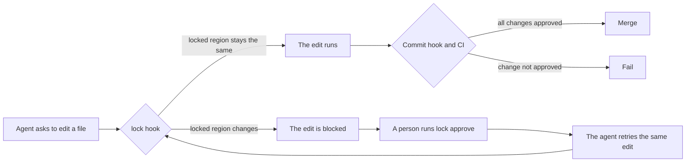

# lock

[](https://github.com/dariodaddamio/lock/actions/workflows/ci.yml)
[](LICENSE)

`lock` prevents coding agents from changing the parts of your repository that you
already decided on.

Coding agents often change text and code that a person already approved, such as
final copy, a released changelog entry, or a tuned animation. Instructions in a
prompt or in `AGENTS.md` do not stop this, because the agent can ignore them or
forget them in a long session. `lock` puts the decision in the repository itself.
You put `LOCKED` comments around a region, and the agent cannot change that region
until a person approves the exact change.

```text
> Change the tagline to "Ship faster."

● Edit(src/pricing.ts)
  ⎿  Blocked by hook: lock: src/pricing.ts has locked regions that this tool call
     would change or remove: `pricing-copy`. Nothing was written. If this change
     is wanted, ask the user to run `lock approve pricing-copy` in their own
     terminal, then retry the same edit.

● The tagline is locked, so I did not change it. If you want this change, run
  `lock approve pricing-copy` in your terminal, and I will retry the edit.
```

## Contents

- [How it works](#how-it-works)
- [Install](#install)
- [Lock a region](#lock-a-region)
- [Approve a change](#approve-a-change)
- [Supported agents](#supported-agents)
- [Commands](#commands)
- [Limits](#limits)
- [Questions](#questions)
- [Contributing](#contributing)

## How it works

`lock` has three layers, and each layer catches what the layer before it cannot
see.



The first layer is the agent hook. Before each file edit, the agent runs
`lock hook`, which reads the file and applies the proposed edit in memory. If a
locked region is different after the edit, the hook blocks the tool call, so the
file on disk does not change. The hook also blocks shell commands that can write
to a locked file, such as `sed -i`, `mv`, `rm`, or a `>` redirect. If `lock` is
not installed or does not work, the hook blocks the edit and does not let it
through.

The second layer is the approval. When the hook blocks an edit, it keeps the
proposed change in `.git/lock/`. A person runs `lock approve`, reads the diff,
and accepts or rejects it. If the person accepts it, `lock` writes an approval
record to `.locks/approvals/`, and the agent can then make that exact edit.

The third layer is the git backstop. `lock check --staged` runs before each
commit, and `lock check --base <ref>` runs in CI. Both compare each lock with
the last commit and fail if a locked region changed without an approval. This
catches changes that did not go through an agent tool, for example a manual edit
or a commit with `--no-verify`.

## Install

1. Download the binary for your system from the
   [releases page](https://github.com/dariodaddamio/lock/releases). Put the
   binary in a directory that is on your `PATH`. If you have Rust, you can build it instead:

   ```sh
   cargo install --git https://github.com/dariodaddamio/lock --locked
   ```

2. In the root directory of your repository, run this command:

   ```sh
   lock install
   ```

   This command adds the agent hook to `.claude/settings.json`,
   `.codex/hooks.json`, and `.cursor/hooks.json`. It also adds `lock check
   --staged` to the git pre-commit hook. To install only some of the hooks, use
   `--git`, `--claude`, `--codex`, or `--cursor`.

3. Commit the agent settings files, so that each clone of the repository gets
   the agent hook. The pre-commit hook is in `.git`, which git does not commit,
   so each clone must run `lock install` one time. A `prepare` script in
   `package.json` can do this automatically.

4. Add the CI check to a workflow, so that each pull request and each push to
   the main branch is checked:

   ```yaml
   name: Locks
   on:
     pull_request:
     push:
       branches: [main]
   jobs:
     locks:
       runs-on: ubuntu-latest
       steps:
         - uses: actions/checkout@v4
           with:
             fetch-depth: 0
         - uses: dariodaddamio/lock@v0.1.0
   ```

5. Make sure that a person must review each approval before it gets to the main
   branch. In the branch protection rule for the main branch, turn on **Require review
   from Code Owners**. Then add these lines to `.github/CODEOWNERS`:

   ```text
   /.locks/                 @your-handle
   /.claude/settings.json   @your-handle
   /.codex/hooks.json       @your-handle
   /.cursor/hooks.json      @your-handle
   /.github/workflows/      @your-handle
   ```

## Lock a region

Put a `START` marker before the region and an `END` marker after it. Write each
marker as a comment in the language of the file, at the start of its own line.
The id contains only lowercase letters, digits, and hyphens, and it must be
unique in the file. You can write a note after `START` or `END`.

```ts
/* LOCKED: pricing-copy START - approved by design on 2026-10-30 */
export const tagline = "Pay for what you ship.";
/* LOCKED: pricing-copy END */
```

```md
<!-- LOCKED: release-history START -->
## 1.0.0 - October 30, 2026
<!-- LOCKED: release-history END -->
```

| File types | Marker comment |
| --- | --- |
| JavaScript, TypeScript, CSS, Rust, Go, Java, C, C#, Swift, Kotlin, PHP | `/*`, `//`, or `{/*` in JSX |
| Markdown, MDX, HTML, SVG, XML | `<!--` |
| Vue, Svelte, Astro | All of the above |
| Python, Ruby, shell, PowerShell, YAML, TOML | `#` |
| SQL, Lua, Haskell | `--` |

A marker in a fenced code block in Markdown is an example, so it does not lock
anything. If a `START` marker has no `END` marker, or if one region is inside
another region, `lock` reports an error. Until a person corrects the markers, the hook blocks
all edits to that file.

To lock a file that cannot contain comments, such as a JSON file or an image,
add its path to `.locks/files.json`:

```json
{ "files": ["public/catalog.json"] }
```

An agent can add a lock without approval, because a new lock only adds
protection. A change to an existing lock, or the removal of a lock, needs an
approval.

## Approve a change

When the hook blocks an edit that you want, open a terminal in the repository
and run `lock approve`. For each blocked change, `lock` shows the diff of the
locked region and asks you to type `APPROVE <id>`. When you type it, `lock`
writes a record to `.locks/approvals/`, and you tell the agent to retry. Commit
the record together with the change.

An approval permits one exact change and not a period of time. The record
contains a hash of the locked region before the change and a hash of the region
after the change. When the agent retries, the hook calculates the same two
hashes, and it lets the edit through only if they match a record. If the agent
writes different text, even one different character, the hook blocks the edit
again.

An approval does not expire, but it cannot unlock the region again after the
change. When you commit the change, the new content becomes the locked content,
and the next change needs a new approval. The old record stays in
`.locks/approvals/` as history, and it matches only when the region contains the
old content again. The region can get back to the old content only through a
second approval, so the old record cannot open the region by itself.

If you approve a change and the agent does not make it, the record still permits
that exact change later. To cancel an approval that nobody used, delete its file
from `.locks/approvals/`.

If you approve two changes to the same region before you commit, for example A
to B and then B to C, the commit check accepts the change from A to C because
the records connect A to C.

## Supported agents

| Agent | How `lock` checks it |
| --- | --- |
| Claude Code | `PreToolUse` hook for `Edit`, `MultiEdit`, `Write`, `NotebookEdit`, `Bash`, and `PowerShell` |
| Codex | `PreToolUse` hook for `apply_patch`, file edits, and shell commands. `lock` applies each patch in memory. |
| Cursor | `preToolUse` hook for file edits, and `beforeShellExecution` for shell commands |
| Other agents | The commit hook and the CI check. These do not block the edit, but they stop the change before it gets to the main branch. |

To add an agent, see [Contributing](#contributing).

## Commands

| Command | What it does |
| --- | --- |
| `lock hook claude` | Reads one Claude Code tool call on stdin and allows it or blocks it. |
| `lock hook codex` | Does the same for Codex. |
| `lock hook cursor` | Does the same for Cursor. |
| `lock approve [<id> or <path>...] [--reason <text>]` | Shows each blocked or unapproved change and records the changes that you accept. |
| `lock check` | Compares the working tree with `HEAD`. |
| `lock check --staged` | Compares the staged files with `HEAD`. The pre-commit hook runs this command. |
| `lock check --base <ref>` | Compares `HEAD` with the commit where it branched from `<ref>`. CI runs this command. |
| `lock list` | Shows all locks in the working tree. |
| `lock install [--git] [--claude] [--codex] [--cursor]` | Adds the hooks to this clone. |

## Limits

The hook sees each file edit before it runs, so it blocks file edits reliably.
A shell command is different, because the hook reads only the text of the
command. A command that makes a file name while it runs, or a script that writes
files, can get past the hook. The commit hook and the CI check find these
changes, and `git commit --no-verify` does not skip the CI check.

An approval record is a plain file, so a person can write one by hand. The hook
does not let an agent write to `.locks/`, and `lock approve` does not run for an
agent, but the guarantee on the main branch comes from code owner review of
`.locks/`. Without that review, use `lock` as a strong guard against agent
mistakes and not as a security boundary.

## Questions

### Why must I run `lock approve` in my own terminal?

`lock approve` runs only when its input and output are an interactive terminal
and the `CI` variable is not set. An agent runs commands through pipes and not
through a terminal, so an agent cannot approve its own change. The hook also
blocks any agent command that contains `lock approve`. For the same reason, a
command that you start through the agent, such as `! lock approve` in Claude
Code, does not work. Open a separate terminal window for approvals.

### Can I lock a whole file?

Yes. Add the path to `.locks/files.json`. This works for any file, including a
file that cannot contain comments.

### Does `lock` slow down the agent?

No. The hook is one small binary, and each check takes approximately 50 ms. The
hook runs `git` only for shell commands that can write files.

### What happens if I remove a lock?

A removal is a change to the lock, so it needs an approval. `lock approve` shows
the removal as a diff, and the record permits only that removal.

## Contributing

Bug reports, ideas, and pull requests are welcome. If you want `lock` to support
another agent, open an issue that shows the JSON that the agent sends to its
hooks. To run the checks, build the binary and run the scenario script:

```sh
cargo build --release
LOCK=target/release/lock bash tests/scenarios.sh
```

## License

[MIT](LICENSE)
