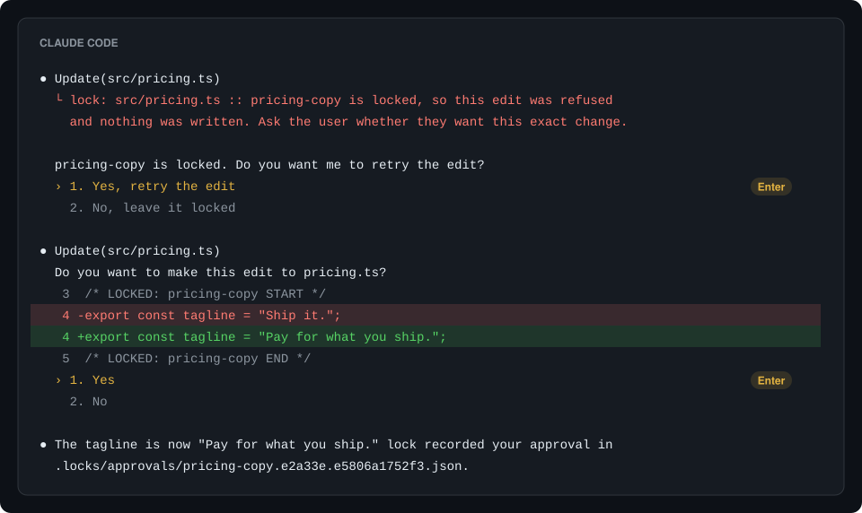
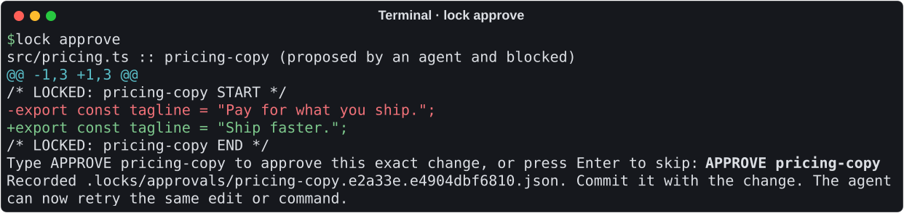

# lock

[](https://github.com/dariodaddamio/lock/actions/workflows/ci.yml)
[](https://github.com/dariodaddamio/lock/releases/latest)
[](https://crates.io/crates/lock-hook)
[](LICENSE)

`lock` prevents coding agents from being able to change parts of your repo that
must not be changed.


Some parts of a project are settled, such as the copy on a landing page, a
released changelog entry, or the timing of an animation. A coding agent cannot
tell which parts those are, so it improves whatever looks improvable, and a rule in
`AGENTS.md` does not stop it, because an agent can forget a rule in a long session.
With `lock`, you mark the settled parts once, and from then on an agent cannot
change them unless you approve the exact change.

## Quick start

Install `lock` on macOS, on Linux, or in Git Bash on Windows:

```sh
curl -fsSL https://raw.githubusercontent.com/dariodaddamio/lock/main/install.sh | sh
```

Or in PowerShell on Windows:

```powershell
irm https://raw.githubusercontent.com/dariodaddamio/lock/main/install.ps1 | iex
```

With Rust, `cargo install lock-hook` installs the same `lock` command.

Then run this in the root of your repository, and commit the files that it adds:

```sh
lock install
```

That is all the setup. Now tell your agent what to lock, for example "Lock the
pricing tagline." The agent puts two comment lines around the text, and from then
on `lock` refuses every change to that text that you have not approved.

Each agent asks you once before it runs hooks from a repository. Claude Code asks
whether you trust the folder, Codex asks you to trust the folder and then to review
the new hooks, and Cursor reads `.cursor/hooks.json` when it opens the project. An
agent finds `lock` on the PATH that it had when it started, so restart an agent
that was already running when you installed `lock`. Codex keeps a background
server, which `codex app-server daemon restart` restarts. Codex also stops running
a hook that changed until you review it again, so after `lock install` updates the
hooks, open `/hooks` in Codex and trust them.

## At a glance

| | |
| --- | --- |
| Agents | Claude Code, Codex, and Cursor |
| Platforms | macOS (Apple silicon and Intel), Linux (x64 and ARM64), and Windows (x64 and ARM64) |
| File types | Most code, style, markup, and config files, as [listed below](#lock-markers). Any other file can be locked as a whole. |
| Requirements | git. There is no runtime, server, account, or background process. |
| Size | One binary of 0.7 to 0.8 MB, which uses about 5 MB of memory while it runs |
| Speed | 1 to 8 ms before an edit and 12 to 112 ms for the commit check, whatever the size of the repository. See [Speed and size](#speed-and-size). |

## What lock is

`lock` is one small command-line program that works through three things in your
repository:

| Part | What it is | Who writes it |
| --- | --- | --- |
| Lock markers | Two comment lines, `LOCKED: <id> START` and `LOCKED: <id> END`, around the text that must not change | Your agent, when you ask it to lock something |
| Hooks | Settings that make each agent run `lock` before and after each tool call and at the end of each turn, and a git hook that runs `lock` before each commit | `lock install` |
| Approval records | Small JSON files in `.locks/approvals/`, each of which allows one exact change to a locked region | You, with `lock approve` or in the Claude Code chat |

`lock install` writes these files, and running it again changes nothing:

| File | What `lock install` adds | Commit it? |
| --- | --- | --- |
| `.claude/settings.json` | The hooks for Claude Code | Yes |
| `.codex/hooks.json` | The hooks for Codex | Yes |
| `.cursor/hooks.json` | The hooks for Cursor | Yes |
| `.git/hooks/pre-commit` | The commit check | No, because git does not share hooks. Each clone runs `lock install` once. |

A teammate who clones the repository gets the agent hooks with it. Until they
install `lock`, the Claude Code and Cursor hooks refuse every agent edit and tell
the agent where to get `lock`. Codex lets a call through when its hook fails, so in
Codex each call shows a failed hook instead, and CI catches the change. In a
JavaScript project, a
`"prepare": "lock install"` script in `package.json` sets up each clone on
`npm install`.

## Using lock

You make the decisions and your agent does the writing, so in practice you do one
of four things:

| You want to | You do this | What lock does |
| --- | --- | --- |
| Lock some text | Ask your agent, for example "Lock the pricing tagline." | The agent adds the markers. A new lock needs no approval, because it only adds protection. |
| Change locked text yourself | Edit it, run `lock approve` in your terminal, and commit | The approval goes into the same commit. A commit of locked text without an approval is refused. |
| Let the agent change locked text | Ask for the change, and approve it when `lock` asks | Only the exact change that you approved goes through. |
| Remove a lock | Delete the markers and approve that, or approve the agent's edit that deletes them | The lock is gone after the commit. |

## Approve a change

### In the Claude Code chat

When an agent's edit meets a lock, `lock` refuses it and says why in the chat, so
the agent asks you whether you want the change. If you do, the agent tries the same
edit again, and Claude Code shows you the diff in its own edit prompt. Choosing
**Yes** lets the edit through, and `lock` records your approval in
`.locks/approvals/` so that you can commit it with the change.



This works in the Manual, Accept edits, and Auto permission modes. In Bypass
permissions mode, Claude Code shows no prompt, so `lock` refuses the edit instead
and you approve it in your terminal.

### In your terminal

Codex and Cursor cannot ask you from a hook, a shell command cannot be checked
before it runs, and your own edits need an approval too, so for these you run
`lock approve` in your own terminal. It shows each blocked or uncommitted change to
locked text as a diff and records the ones that you accept:



Then tell the agent to retry, and commit the new file in `.locks/approvals/` with
the change. `lock approve` runs only when a person types into the terminal, so
neither an agent nor `! lock approve` inside Claude Code can run it. An agent could
still fake a terminal, so an approval that appears while an agent command is
running is undone when that command ends. `lock approve` warns you when that would
happen, and you approve again after the agent's turn.

### How long an approval lasts

An approval is for one exact change, not for a period of time. The record stores
a fingerprint of the locked text before the change and after it, so a retry that
differs by one character is refused again. After you commit the change, the new
text is the locked text, and the next change needs a new approval. A record that
is committed is used up: it never approves a change again, so an old record
cannot be replayed or chained with another one. An approval that nobody used stays
valid for that one change until you delete its file from `.locks/approvals/`.

## How it works

`lock` checks each change to locked text at five points:

| When | What lock checks | What happens to an unapproved change |
| --- | --- | --- |
| Before an agent edit | The edit, applied to the file in memory | The edit is refused, and nothing is written. |
| Around any other agent tool call, such as a shell command or an MCP tool | Each locked file, the lock configuration, the agent settings, and git's `core.hooksPath`, before and after the call | The change is put back, and the agent is told why. |
| At the end of a turn | Each command that the agent ran in the background | The locked text is put back, and you are told. |
| Before a commit | Each locked change in the commit | The commit is refused until you approve the change. |
| In CI | Each locked change since the base branch | The check fails. |

An agent's edit tool sends the hook the exact text that it wants to replace, so
`lock` can apply the edit to a copy of the file in memory and compare each locked
region before and after. An edit to the same file outside the locked region goes
through as usual.

<details>
<summary>The tool call and the answer from <code>lock</code></summary>

The agent sends:

```json
{
  "tool_name": "Edit",
  "tool_input": {
    "file_path": "src/pricing.ts",
    "old_string": "export const tagline = \"Pay for what you ship.\";",
    "new_string": "export const tagline = \"Ship faster.\";"
  }
}
```

`lock` answers:

```json
{
  "hookSpecificOutput": {
    "hookEventName": "PreToolUse",
    "permissionDecision": "deny",
    "permissionDecisionReason": "lock: src/pricing.ts :: pricing-copy is locked, so this edit was refused and nothing was written. ..."
  }
}
```

</details>

A script can write anything, so `lock` checks its result instead. Before a shell
command or any other tool that can write, such as an MCP tool, `lock` copies each
file that holds a lock, and after the call it puts back any locked text that changed
without approval. All other changes stay. A command that runs in the background
reports back before it is done, so `lock` checks it again when the turn ends.


The same check guards everything that decides whether `lock` runs at all. An agent
cannot write an approval record, remove a whole-file lock, change or remove the
lock hook entries, turn hooks off in its own settings in the repository or in your
home folder, distrust the Codex hooks, or point git's `core.hooksPath` away from the
commit check. An edit that would do one of these is refused, and a command that did
is undone. A command that changes the commit hook in any way, commits locked text
without approval while skipping the hook, or deletes the copies that `lock` keeps
while it runs is undone too: its commits are reset with their changes kept, and the
locked text goes back to its last approved state. Paths are compared the way the
file system compares them, so a different case or a symbolic link does not lead
around a lock, and files that are not valid UTF-8 are compared and restored byte for
byte.

The commit hook does not guess who made a change. A change that no hook saw could
come from you, from an agent without hooks, or from a process that an agent left
running, so every locked change needs an approval before it can be committed. If
`lock` cannot check an edit, the hook refuses the edit instead of letting it
through.

## Speed and size

Each hook is a short process that starts, checks, and exits. A tool that only reads,
such as a file read or a search, passes as soon as `lock` sees its name. These are
the medians
of 40 runs on GitHub's hosted runners, in a generated repository with 10,000 files
and 300 locks. The [CI benchmark](.github/workflows/ci.yml) measures them again on
each push to the main branch, and it also measures repositories with 10 and 1,000
files.

| Step | Linux | macOS | Windows |
| --- | --- | --- | --- |
| Before an edit, inside or outside a locked region | 1 ms | 5 to 8 ms | 4 ms |
| Before a shell command | 80 ms | 222 ms | 177 ms |
| After a shell command | 10 ms | 39 ms | 64 ms |
| The commit check | 12 ms | 77 ms | 112 ms |

An edit is checked in memory, so its time does not grow with the repository. The
check before a shell command copies each file that holds a lock, so its time grows
with the number of locked files: with 30 locks it takes 12 ms on Linux, 39 ms on
macOS, and 57 ms on Windows. The commit check reads only the files that the commit
changes.

The binary is 0.7 to 0.8 MB, and a process uses about 5 MB of memory. An approval
record is about 350 bytes. While an agent command runs, `lock` keeps a copy of
each locked file in `.git/lock/`, and it removes the copies when the agent's turn
ends. To measure your own machine, run `python3 tests/bench.py <path to lock>`.

## Lock markers

Your agent writes the markers, so you do not need to learn them. This section is
for reference.

```ts
/* LOCKED: pricing-copy START */
export const tagline = "Pay for what you ship.";
/* LOCKED: pricing-copy END */
```

```md
<!-- LOCKED: release-history START -->
## 1.0.0 - October 30, 2026
<!-- LOCKED: release-history END -->
```

| File types | The markers are written as |
| --- | --- |
| JavaScript, TypeScript, JSX, TSX, CSS, SCSS, Less | `/* */`, `//`, or `{/* */}` in JSX |
| Rust, Go, Java, Kotlin, Swift, C, C++, C#, PHP, Scala, Dart, Zig | `/* */` or `//` |
| Markdown, MDX, HTML, SVG, XML | `<!-- -->` |
| Vue, Svelte, Astro | Any of the above |
| Python, Ruby, shell, PowerShell, YAML, TOML, Terraform, Nix | `#` |
| SQL, Lua, Haskell, Elm | `--` |
| Any other file, such as JSON or an image | A whole-file lock in `.locks/files.json` |

- Each marker is a comment at the start of its own line, and the id uses lowercase
  letters, digits, and hyphens and is unique in its file.
- Text after `START` or `END` is a note for people, and `lock` ignores it.
- A region cannot be inside another region.
- In Markdown, a marker inside a fenced code block is an example, so it does not
  lock anything.
- A broken marker, such as a `START` without an `END`, blocks every agent edit to
  that file until someone repairs it.

To lock a file that cannot hold a comment, add its path to `.locks/files.json`:

```json
{ "files": ["public/catalog.json"] }
```

## Set up a team repository

For a repository that other people or a CI system use, add two things.

First, run the check on each pull request and on each push to the main branch:

```yaml
name: Locks
on:
  pull_request:
  push:
    branches: [main]
jobs:
  locks:
    runs-on: ubuntu-latest
    steps:
      - uses: actions/checkout@v4
        with:
          fetch-depth: 0
      - uses: dariodaddamio/lock@v0.3.0
```

Second, make sure that a person reviews each approval before it reaches the main
branch. In the branch protection rule for the main branch, turn on **Require
review from Code Owners**, and add these lines to `.github/CODEOWNERS`:

```text
/.locks/                 @your-handle
/.claude/settings.json   @your-handle
/.codex/hooks.json       @your-handle
/.cursor/hooks.json      @your-handle
/.github/workflows/      @your-handle
```

## Commands

| Command | What it does |
| --- | --- |
| `lock install [--git] [--claude] [--codex] [--cursor]` | Adds the hooks to this clone. With no options, it adds all of them. |
| `lock approve [<id> or <path>...] [--reason <text>]` | Shows each blocked or unrecorded change and records the ones that you accept. |
| `lock list` | Shows each lock in the working tree. |
| `lock check` | Compares the working tree with `HEAD`. |
| `lock check --staged` | Checks the staged changes, and fails for a locked change without an approval. The commit hook runs this. |
| `lock check --base <ref>` | Compares `HEAD` with the point where it branched from `<ref>`. CI runs this. |
| `lock uninstall` | Removes the hooks that `lock install` added. The markers and `.locks/` stay. |
| `lock hook claude`, `lock hook codex`, `lock hook cursor` | The agent hook. The agent runs it and sends one tool call on stdin. |

## Limits

`lock` is built so that no tool call, script, or settings change by an agent can
change locked text without your approval. An agent runs as you, on your machine, so
a few cases remain, and each one is caught before the change can be committed or
merged:

- A process that an agent starts and that keeps running after the agent's turn
  ends can still change a locked file. The change stays on disk, but it cannot be
  committed until you approve it, and `lock approve` shows it to you first.
- Such a process could also write an approval record, because a record is a plain
  file. On the main branch, code owner review of `.locks/` makes sure that a person
  accepted each record.
- Codex lets a call through when its hook fails, when `lock` is not installed, or
  when the hooks changed and you have not reviewed them yet. The commit check and
  CI still catch the change.
- An agent without hooks is not checked when it edits. Its change cannot be
  committed without your approval.
- `git commit --no-verify` run by a person, or in a clone where nobody ran
  `lock install`, skips the commit check. CI fails the pull request instead.

Two more cases are allowed on purpose. A command that returns locked text to its
committed state, such as `git checkout` or `git stash`, is not undone, so an agent
can discard an edit to locked text that you have not committed yet, as with any
other file. While a merge or a rebase stops on a conflict, `lock` does not undo
changes, and the commit hook checks the result.

Approval in the Claude Code chat trusts Claude Code's edit prompt. A
`PermissionRequest` hook or a permission callback could answer that prompt without
you, so `lock` refuses the edit instead of asking when it finds such a hook in your
Claude Code settings or plugins, and agents cannot add one.

## Questions

### Why not a rule in `AGENTS.md`?

| Approach | What it misses |
| --- | --- |
| A rule in `AGENTS.md` or `CLAUDE.md` | The agent can forget the rule, or decide that it does not apply. |
| Read-only file permissions | They protect whole files only, and an agent can change the permissions back. |
| Code owner review | It finds the change in review, after the agent has made it. |
| `lock` | It stops the change at the tool call, for any part of a file, and checks again at commit and in CI. |

### What if the agent commits my edit?

The commit is refused until you approve your edit with `lock approve`. After that,
the agent's commit goes through, with your approval in it.

### Can I add another agent?

Yes, if the agent can run a hook before and after each tool call. [Open an issue](https://github.com/dariodaddamio/lock/issues/new?template=agent.yml)
with an example of the JSON that the agent sends to its hooks.

### How do I remove lock?

Run `lock uninstall` in the repository, then delete the binary. The lock markers
and `.locks/` stay, so `lock install` brings the protection back.

## Contributing

Bug reports, ideas, and pull requests are welcome. [CONTRIBUTING.md](CONTRIBUTING.md)
explains how to build and check `lock`, and [SECURITY.md](SECURITY.md) explains
how to report a way around it.

## License

[MIT](LICENSE)
