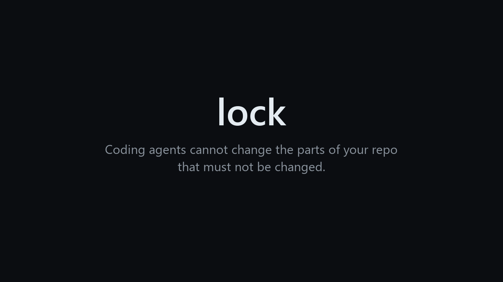
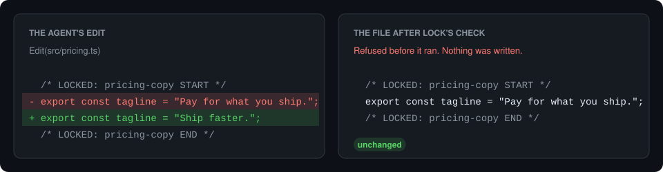
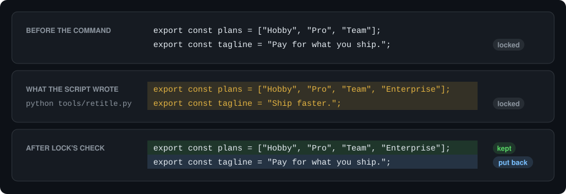

# lock

[](https://github.com/dariodaddamio/lock/actions/workflows/ci.yml)
[](LICENSE)

`lock` prevents coding agents from being able to change parts of your repo that
must not be changed.



Some parts of a project are settled: the copy on a landing page, a released
changelog entry, or the timing of an animation. A coding agent cannot tell which
parts those are, so it improves whatever looks improvable. A rule in `AGENTS.md`
does not stop it either, because an agent can forget a rule in a long session.
With `lock`, you tell your agent which parts are settled. From then on, the agent
cannot change them unless you approve the exact change.

## What lock is

`lock` is a small command-line program. It is one binary with no runtime, and it
works through three things in your repository:

| Part | What it is | Who writes it |
| --- | --- | --- |
| Lock markers | Two comment lines, `LOCKED: <id> START` and `LOCKED: <id> END`, around the text that must not change | Your agent, when you ask it to lock something |
| Hooks | Settings that make each agent run `lock` before each edit and around each shell command, and a git hook that runs `lock` before each commit | `lock install`, once in each clone |
| Approval records | Small JSON files in `.locks/approvals/`, each of which allows one exact change to a locked region | `lock approve`, or the commit hook when you edit locked text yourself |

There is no server, no account, and no process that runs in the background.

## At a glance

| | |
| --- | --- |
| Agents | Claude Code, Codex, and Cursor |
| Platforms | macOS (Apple silicon and Intel), Linux (x64 and ARM64), and Windows (x64 and ARM64) |
| File types | Most code, style, markup, and config files, listed in the next table. Any other file can be locked as a whole. |
| Install | One command, then `lock install` in each repository. The only other requirement is git. |
| Speed | About 0.05 seconds before an edit and 0.25 seconds around a shell command, measured on Windows in a repository with 28 locks |

| File types | The markers are written as |
| --- | --- |
| JavaScript, TypeScript, JSX, TSX, CSS, SCSS, Less | `/* */`, `//`, or `{/* */}` in JSX |
| Rust, Go, Java, Kotlin, Swift, C, C++, C#, PHP, Scala, Dart, Zig | `/* */` or `//` |
| Markdown, MDX, HTML, SVG, XML | `<!-- -->` |
| Vue, Svelte, Astro | Any of the above |
| Python, Ruby, shell, PowerShell, YAML, TOML, Terraform, Nix | `#` |
| SQL, Lua, Haskell, Elm | `--` |
| Any other file, such as JSON or an image | A whole-file lock in `.locks/files.json` |

## Install

On macOS and Linux, and in Git Bash on Windows:

```sh
curl -fsSL https://raw.githubusercontent.com/dariodaddamio/lock/main/install.sh | sh
```

On Windows, in PowerShell:

```powershell
irm https://raw.githubusercontent.com/dariodaddamio/lock/main/install.ps1 | iex
```

Then run this in the root of each repository that you want to protect:

```sh
lock install
```

`lock install` writes these files. You can run it again at any time, and it does
not add a hook twice.

| File | What `lock install` adds | Commit it? |
| --- | --- | --- |
| `.claude/settings.json` | Hooks that Claude Code runs before each edit, after each shell command, and at the end of each turn | Yes |
| `.codex/hooks.json` | The same hooks for Codex | Yes |
| `.cursor/hooks.json` | The same hooks for Cursor | Yes |
| `.git/hooks/pre-commit` | The commit check | No, because git does not share hooks. Each clone runs `lock install` once. |

In a JavaScript project, a `"prepare": "lock install"` script in `package.json`
runs that step on every `npm install`. To build from source instead, run
`cargo install --git https://github.com/dariodaddamio/lock --locked`.

## Using lock

You make the decisions and your agent does the writing. In practice, you do one
of four things:

| You want to | You do this | What lock does |
| --- | --- | --- |
| Lock some text | Tell your agent, for example "Lock the pricing tagline." | The agent puts markers around the text. A new lock needs no approval, because it only adds protection. |
| Change locked text yourself | Edit it in your editor and commit as usual | The commit hook records the edit in your name. You do not need to approve your own edit. |
| Let the agent change locked text | Ask for the change. When the agent is blocked, run `lock approve`. | The agent retries, and only the exact change that you approved goes through. |
| Remove a lock | Delete the markers and commit, or let the agent delete them and approve that | The lock is gone after the commit. |

When you edit locked text yourself, the commit shows what `lock` recorded:

```console
$ git commit -am "Tweak the tagline"
lock: recorded your edit to src/pricing.ts :: pricing-copy in .locks/approvals/pricing-copy.e2a33e.540703c0ed6d.json.
[main 76ebfec] Tweak the tagline
```

## What the agent sees

### An edit

When an agent edits a file, it sends the hook the exact text that it wants to
replace. `lock` applies the edit to a copy of the file in memory and compares each
locked region before and after. If a region would change and there is no approval
for that change, `lock` refuses the tool call, so the file is never written. An
edit to the same file outside the locked region goes through as usual.



<details>
<summary>The tool call and the answer from <code>lock</code></summary>

The agent sends:

```json
{
  "tool_name": "Edit",
  "tool_input": {
    "file_path": "src/pricing.ts",
    "old_string": "export const tagline = \"Pay for what you ship.\";",
    "new_string": "export const tagline = \"Ship faster.\";"
  }
}
```

`lock` answers:

```json
{
  "hookSpecificOutput": {
    "hookEventName": "PreToolUse",
    "permissionDecision": "deny",
    "permissionDecisionReason": "lock: src/pricing.ts has locked regions that this tool call would change or remove: `pricing-copy`. Nothing was written. ..."
  }
}
```

</details>

### A shell command or a script

`lock` cannot know in advance what a script will write, so it checks the result
instead. Before the command runs, `lock` copies each file that holds a lock. After
the command, it compares the files with the copies and puts back any locked text
that changed without approval. All other changes stay, and the agent is told what
was put back.



The same check undoes a command that writes an approval record, edits the lock
configuration, or removes the hook from the agent settings.

## Approve a change

When the agent proposes a change to locked text that you do want, run
`lock approve` in your own terminal, as in the animation at the top:

1. `lock approve` shows each change that was blocked, as a diff of the locked
   region.
2. Type `APPROVE <id>` to accept a change, or press Enter to skip it.
3. Tell the agent to retry. The same edit, or the same command, now goes through.
4. Commit the new file in `.locks/approvals/` together with the change.

### How long an approval lasts

An approval is for one exact change, not for a period of time.

- The record stores a fingerprint of the region before the change and a
  fingerprint after it. A retry that differs by one character is refused again.
- After you commit the change, the new text is the locked text, and the next
  change needs a new approval.
- An old record cannot open the region again, because it matches only the old
  text.
- An approval that nobody used stays valid for that one change. To cancel it,
  delete its file from `.locks/approvals/`.

## How it works

`lock` checks every change to locked text at four points:

| When | What lock checks | What happens to an unapproved change |
| --- | --- | --- |
| Before an agent edit | The edit, applied to the file in memory | The edit is refused, and nothing is written. |
| Around an agent shell command | Each locked file, before and after the command | The locked text is put back, and the agent is told why. |
| Before a commit | Each locked change in the commit | Your own edit is recorded as an approval. A change made by an agent command stops the commit. |
| In CI | Each locked change since the base branch | The check fails. |

The commit hook tells your edits from an agent's edits by when they happen. While
an agent command runs, `lock` holds a copy of each locked file. A change that is
already in that copy was made before the command started, so it is yours. A change
that is not in the copy was made by the command. When the agent's turn ends, `lock`
removes the copies.

If `lock` is not installed or cannot check an edit, the hook refuses the edit
instead of letting it through.

## Lock markers

Your agent writes the markers, so you do not need to learn them. This section is
for reference.

```ts
/* LOCKED: pricing-copy START */
export const tagline = "Pay for what you ship.";
/* LOCKED: pricing-copy END */
```

```md
<!-- LOCKED: release-history START -->
## 1.0.0 - October 30, 2026
<!-- LOCKED: release-history END -->
```

- Each marker is a comment at the start of its own line.
- The id uses lowercase letters, digits, and hyphens, and it is unique in its file.
- Text after `START` or `END` is a note for people, and `lock` ignores it.
- A region cannot be inside another region.
- In Markdown, a marker inside a fenced code block is an example, so it does not
  lock anything.
- A broken marker, such as a `START` without an `END`, blocks every agent edit to
  that file until someone repairs it.

To lock a file that cannot hold a comment, add its path to `.locks/files.json`:

```json
{ "files": ["public/catalog.json"] }
```

## Set up a team repository

For a repository that other people or a CI system use, add two things.

First, run the check on each pull request and on each push to the main branch:

```yaml
name: Locks
on:
  pull_request:
  push:
    branches: [main]
jobs:
  locks:
    runs-on: ubuntu-latest
    steps:
      - uses: actions/checkout@v4
        with:
          fetch-depth: 0
      - uses: dariodaddamio/lock@v0.1.0
```

Second, make sure that a person reviews each approval before it reaches the main
branch. In the branch protection rule for the main branch, turn on **Require
review from Code Owners**, and add these lines to `.github/CODEOWNERS`:

```text
/.locks/                 @your-handle
/.claude/settings.json   @your-handle
/.codex/hooks.json       @your-handle
/.cursor/hooks.json      @your-handle
/.github/workflows/      @your-handle
```

## Commands

| Command | What it does |
| --- | --- |
| `lock install [--git] [--claude] [--codex] [--cursor]` | Adds the hooks to this clone. With no options, it adds all of them. |
| `lock approve [<id> or <path>...] [--reason <text>]` | Shows each blocked or unrecorded change and records the ones that you accept. |
| `lock list` | Shows each lock in the working tree. |
| `lock check` | Compares the working tree with `HEAD`. |
| `lock check --staged --record` | Checks the staged changes and records your own edits. The commit hook runs this. |
| `lock check --base <ref>` | Compares `HEAD` with the point where it branched from `<ref>`. CI runs this. |
| `lock hook claude`, `lock hook codex`, `lock hook cursor` | The agent hook. The agent runs it and sends one tool call on stdin. |

## Limits

`lock` knows which changes an agent made because the agent's hooks report each
edit and command. A change that no hook reports looks like your own edit, so the
commit hook records it. That happens in these cases:

- An agent that `lock` does not support, such as one without hooks, edits a file.
- A process that an agent starts in the background writes to a locked file after
  the command has ended.

Two more cases are allowed on purpose:

- A command that returns locked text to its committed state, such as
  `git checkout` or `git stash`, is not undone. An agent can therefore discard an
  edit to locked text that you have not committed yet, as with any other file.
- While a merge or a rebase stops on a conflict, `lock` does not undo changes. The
  commit hook checks the result.

An approval record is a plain file. The hooks stop agents from writing one, and a
person can still write one by hand. On the main branch, code owner review of
`.locks/` makes sure that a person accepted each record.

## Questions

### Why not a rule in `AGENTS.md`?

| Approach | What it misses |
| --- | --- |
| A rule in `AGENTS.md` or `CLAUDE.md` | The agent can forget the rule, or decide that it does not apply. |
| Read-only file permissions | They protect whole files only, and an agent can change the permissions back. |
| Code owner review | It finds the change in review, after the agent has made it. |
| `lock` | It stops the change at the tool call, for any part of a file, and checks again at commit and in CI. |

### Why does `lock approve` need my own terminal?

An approval must come from a person. `lock approve` runs only when a person types
into an interactive terminal, and it does not run when the `CI` variable is set.
Agents run commands without a keyboard, so `lock approve` refuses them, and the
hook also refuses any agent command that runs `lock approve`. A command that you
start through the agent, such as `! lock approve` in Claude Code, also runs
without a keyboard, so it is refused too.

### What if the agent commits my edit?

That works. When the agent runs `git commit`, the commit hook compares each locked
change with the copy taken when the command started. Your edit was already there,
so `lock` records it in your name. A change that the same command made is refused.

### Can I add another agent?

Yes, if the agent can run a hook before each tool call and after each shell
command. Open an issue with an example of the JSON that the agent sends to its
hooks.

## Contributing

Bug reports, ideas, and pull requests are welcome. To build `lock` and run the
checks:

```sh
cargo build --release
LOCK="$PWD/target/release/lock" bash tests/scenarios.sh
```

## License

[MIT](LICENSE)
