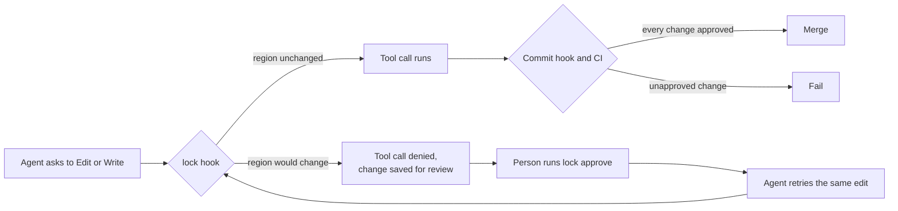

# lock

`lock` stops coding agents from changing the parts of a repository that you have
finished. You mark a region with a pair of `LOCKED` comments. When Claude Code or
Cursor asks to edit a file, `lock` runs before the edit, works out what the file
would look like afterwards, and denies the tool call if a locked region would
change. The agent gets a message that explains why and what to do next, and the
file on disk is never touched.

A person can still let a change through. They run `lock approve` in their own
terminal, read the exact change, and confirm it. The approval is a small JSON
file that is committed with the change, so every clone and every CI run agrees on
what is locked and what was approved. A commit hook and a CI check compare every
lock with git as a backstop, for changes that never went through an agent tool.

`lock` is one binary with no runtime dependencies. It needs git.

## How a lock holds

A lock has three layers: the agent hook, the approval, and the git backstop. The
hook is the one that matters day to day, and the other two make sure nothing gets
past it unnoticed.



1. Claude Code and Cursor call `lock hook` before every file edit and every
   shell command. For an edit, the hook reads the file, applies
   the proposed `Edit`, `MultiEdit`, or `Write` in memory, and compares each
   locked region before and after. If any region would change or disappear
   without an approval, the hook denies the call. It also denies an edit whose
   old text does not match the file exactly, a patch or notebook edit to a
   locked file, an attempt to write an approval record, and an edit that would
   remove the hook from `.claude/settings.json` or `.cursor/hooks.json` or turn
   hooks off. For a shell command, the hook denies anything that could write to
   a locked file, such as `sed -i`, a redirect, `mv`, `rm`, or `Set-Content`,
   and any command that runs `lock approve`. If the hook itself fails or is not
   installed, the tool call is blocked rather than allowed.
2. When the hook denies an edit, it saves the proposed change
   inside `.git`. You run `lock approve`, read the diff, and type
   `APPROVE <id>` to accept it. `lock approve` writes a record to
   `.locks/approvals/` that names the region and the hashes of its content
   before and after. The agent then retries the same edit, and the hook lets it
   through because a record matches it exactly. Any other change to the region
   is still denied.
3. `lock check --staged` runs in the pre-commit hook and
   `lock check --base <ref>` runs in CI. Both compare every lock with the last
   commit and fail on a change that has no matching approval. This catches a
   person who edited a locked region by hand without approving it, a shell
   command that got past the hook, and a commit made with `--no-verify`.

## Mark a region

Write the markers as comments in the syntax of the file. Each marker must be the
first thing on its line, and the id uses lowercase letters, digits, and hyphens.
Anything after `START` or `END` is a free-form note.

```ts
/* LOCKED: pricing-copy START - approved by design on 2026-10-30 */
export const tagline = "Pay for what you ship.";
/* LOCKED: pricing-copy END */
```

```md
<!-- LOCKED: release-history START -->
## 1.0.0 - October 30, 2026
<!-- LOCKED: release-history END -->
```

| Files | Marker comment |
| --- | --- |
| JavaScript, TypeScript, CSS, Rust, Go, Java, C, C#, Swift, Kotlin, PHP | `/*`, `//`, or `{/*` in JSX |
| Markdown, MDX, HTML, SVG, XML | `<!--` |
| Vue, Svelte, Astro | any of the above |
| Python, Ruby, shell, PowerShell, YAML, TOML | `#` |
| SQL, Lua, Haskell | `--` |

Markers inside a fenced code block in Markdown are examples, so they do not
create a lock. A marker without its pair, or a region inside another region, is
an error, and the hook blocks edits to that file until a person fixes it.

A file that cannot hold a comment, such as JSON or an image, is locked as a
whole by listing it in `.locks/files.json`:

```json
{ "files": ["public/catalog.json"] }
```

Adding a lock never needs approval, because it only adds protection, so an agent
may add markers or add entries to `.locks/files.json`. Changing or removing a
lock needs approval.

## Install

1. Install the binary. Download it from the
   [releases page](https://github.com/dariodaddamio/lock/releases) and put it on
   your `PATH`, or build it with Cargo:

   ```sh
   cargo install --git https://github.com/dariodaddamio/lock --locked
   ```

2. In the repository, run:

   ```sh
   lock install
   ```

   This adds the agent hook to `.claude/settings.json` and `.cursor/hooks.json`
   and adds `lock check --staged` to the git pre-commit hook. Commit the two
   settings files so that every clone gets the agent hook. The pre-commit hook
   lives in `.git` and is not committed, so each clone runs `lock install` once,
   for example from a `prepare` script. Use `--git`, `--claude`, or `--cursor`
   to install only some of the hooks.

3. Run the check on every pull request and on pushes to the protected branch:

   ```yaml
   name: Locks
   on:
     pull_request:
     push:
       branches: [main]
   jobs:
     locks:
       runs-on: ubuntu-latest
       steps:
         - uses: actions/checkout@v4
           with:
             fetch-depth: 0
         - uses: dariodaddamio/lock@v0.1.0
   ```

4. Make approvals and the hook configuration reviewable by a person. Add the
   following to `.github/CODEOWNERS` and turn on **Require review from Code
   Owners** for the protected branch:

   ```text
   /.locks/                 @your-handle
   /.claude/settings.json   @your-handle
   /.cursor/hooks.json      @your-handle
   /.github/workflows/      @your-handle
   ```

## Commands

| Command | What it does |
| --- | --- |
| `lock hook claude` | Reads one Claude Code `PreToolUse` call on stdin and allows or denies it. |
| `lock hook cursor` | The same for Cursor `preToolUse` and `beforeShellExecution`. |
| `lock approve [<id>\|<path>...] [--reason <text>]` | Shows each blocked or unapproved change and records the ones you confirm. Runs only at an interactive terminal. |
| `lock check` | Compares the working tree with `HEAD`. |
| `lock check --staged` | Compares the index with `HEAD`. This is the pre-commit check. |
| `lock check --base <ref>` | Compares `HEAD` with its merge base with `<ref>`. This is the CI check. |
| `lock list` | Prints every lock in the working tree. |
| `lock install [--git] [--claude] [--cursor]` | Registers the hooks in this clone. |

## What a lock does not stop

The agent hook sees each tool call before it runs, so edits through the agent's
file tools are blocked reliably. Shell commands are different: the hook reads the
command text, and a command that builds a file name at run time, or a script that
writes files, can get past it. The commit hook and the CI check catch those
changes, and `git commit --no-verify` skips only the commit hook, not CI.

An approval record is a plain file, so someone could write one by hand.
`lock approve` refuses to run without an interactive terminal, and the hook
blocks agents from writing under `.locks/`, but the guarantee on the protected
branch comes from code-owner review of `.locks/`. Without that review, treat a
lock as a strong guardrail for agents rather than a security boundary.

## License

MIT
