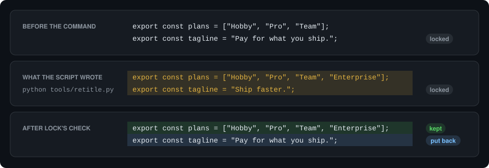

# How it works

`lock` checks each change to locked text at five points:

| When | What lock checks | What happens to an unapproved change |
| --- | --- | --- |
| Before an agent edit | The edit, applied to the file in memory | The edit is refused, and nothing is written. |
| Around any other agent tool call, such as a shell command or an MCP tool | Each locked file, the lock configuration, the agent settings, and git's `core.hooksPath`, before and after the call | The change is put back, and the agent is told why. |
| At the end of a turn | Each command that the agent ran in the background | The locked text is put back, and you are told. |
| Before a commit | Each locked change in the commit | The commit is refused until you approve the change. |
| In CI | Each locked change since the base branch | The check fails. |

An agent's edit tool sends the hook the exact text that it wants to replace, so
`lock` can apply the edit to a copy of the file in memory and compare each locked
region before and after. An edit to the same file outside the locked region goes
through as usual. A tool that only reads, such as a file read or a search, passes
as soon as `lock` sees its exact name, with no snapshot.

<details>
<summary>The tool call and the answer from lock</summary>

The agent sends:

```json
{
  "tool_name": "Edit",
  "tool_input": {
    "file_path": "src/pricing.ts",
    "old_string": "export const tagline = \"Pay for what you ship.\";",
    "new_string": "export const tagline = \"Ship faster.\";"
  }
}
```

`lock` answers:

```json
{
  "hookSpecificOutput": {
    "hookEventName": "PreToolUse",
    "permissionDecision": "deny",
    "permissionDecisionReason": "lock: src/pricing.ts :: pricing-copy is locked, so this edit was refused and nothing was written. ..."
  }
}
```

</details>

A script can write anything, so `lock` checks its result instead. Before a shell
command or any other tool that can write, such as an MCP tool, `lock` copies each
file that holds a lock and differs from the commit recorded at the start of the
call, and after the call it puts back any locked text that changed without
approval. All other changes stay. A command that runs in the background reports
back before it is done, so `lock` checks it again when the turn ends.



The same check guards everything that decides whether `lock` runs at all. An agent
cannot write an approval record, remove a whole-file lock, change or remove the
lock hook entries, turn hooks off in its own settings in the repository or in your
home folder, distrust the Codex hooks, or point git's `core.hooksPath` away from the
commit check. An edit that would do one of these is refused, and a command that did
is undone. A command that changes the commit hook in any way, commits locked text
without approval while skipping the hook, or deletes the copies that `lock` keeps
while it runs is undone too: its commits are reset with their changes kept, and the
locked text goes back to its last approved state. Paths are compared the way the
file system compares them, so a different case or a symbolic link does not lead
around a lock, and files that are not valid UTF-8 are compared and restored byte for
byte.

The commit hook does not guess who made a change. A change that no hook saw could
come from you, from an agent without hooks, or from a process that an agent left
running, so every locked change needs an approval before it can be committed. If
`lock` cannot check an edit, the hook refuses the edit instead of letting it
through.

## Speed and size

Each hook is a short process that starts, checks, and exits. These are the medians
of 40 runs on GitHub's hosted runners, in a generated repository with 10,000 files
and 300 locks. The [CI benchmark](https://github.com/dariodaddamio/lock/blob/main/.github/workflows/ci.yml)
measures them again on each push to the main branch.

| Step | Linux | macOS | Windows |
| --- | --- | --- | --- |
| Before an edit, inside or outside a locked region | 1 ms | 4 ms | 7 ms |
| Before a shell command | 74 ms | 181 ms | 405 ms |
| After a shell command | 9 ms | 34 ms | 139 ms |
| The commit check | 10 ms | 77 ms | 190 ms |

An edit is checked in memory, so its time does not grow with the repository. The
check before a shell command copies locked files that differ from HEAD, so its
time grows with how many of those files have local edits. The commit check reads
only the files that the commit changes.

| Size | |
| --- | --- |
| Installed binary | 0.75 to 0.9 MB |
| What the installer downloads | 350 to 480 KB, depending on your system |
| Dependencies | Two |
| Memory while it runs | About 5 MB |
| An approval record | About 350 bytes |
| Copies while an agent command runs | One of each locked file that differs from HEAD, in `.git/lock/`, removed when the agent's turn ends |
