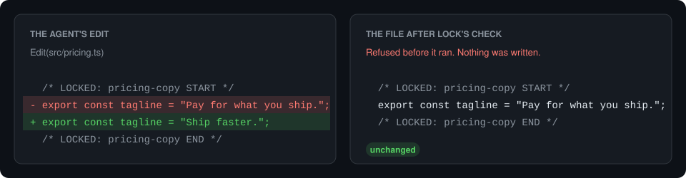

# lock
{: .fs-9 }

`lock` prevents coding agents from being able to change parts of your repo that
must not be changed.
{: .fs-6 .fw-300 }

[Get started](#quick-start){: .btn .btn-primary .fs-5 .mb-4 .mb-md-0 .mr-2 }
[View on GitHub](https://github.com/dariodaddamio/lock){: .btn .fs-5 .mb-4 .mb-md-0 }



Some parts of a project are settled, such as the copy on a landing page, a
released changelog entry, or the timing of an animation. A coding agent cannot
tell which parts those are, so it improves whatever looks improvable, and a rule in
`AGENTS.md` does not stop it, because an agent can forget a rule in a long session.
With `lock`, you mark the settled parts once, and from then on an agent cannot
change them unless you approve the exact change.

## Quick start

Install `lock` on macOS, on Linux, or in Git Bash on Windows:

```sh
curl -fsSL https://raw.githubusercontent.com/dariodaddamio/lock/main/install.sh | sh
```

Or in PowerShell on Windows:

```powershell
irm https://raw.githubusercontent.com/dariodaddamio/lock/main/install.ps1 | iex
```

With Rust, `cargo install lock-hook` installs the same `lock` command.

Then run this in the root of your repository, and commit the files that it adds:

```sh
lock install
```

That is all the setup. Now tell your agent what to lock, for example "Lock the
pricing tagline." The agent puts two comment lines around the text, and from then
on `lock` refuses every change to that text that you have not approved.

Each agent asks you once before it runs hooks from a repository. Claude Code asks
whether you trust the folder, Codex asks you to trust the folder and then to review
the new hooks, and Cursor reads `.cursor/hooks.json` when it opens the project. An
agent finds `lock` on the PATH that it had when it started, so restart an agent
that was already running when you installed `lock`. Codex keeps a background
server, which `codex app-server daemon restart` restarts. Codex also stops running
a hook that changed until you review it again, so after `lock install` updates the
hooks, open `/hooks` in Codex and trust them.

`lock install` ends with these steps for your agents. Run `lock doctor` afterwards to
check them: it prints a PASS, WARN, or FAIL line for each part of the setup and says how
to fix it. A missing hook file for an agent that you use is a FAIL. If the hook files are in `.gitignore`, `lock install` and `lock doctor`
warn you, because teammates do not get files that git ignores.

## At a glance

| | |
| --- | --- |
| Agents | Claude Code, Codex, and Cursor |
| Platforms | macOS (Apple silicon and Intel), Linux (x64 and ARM64), and Windows (x64 and ARM64) |
| File types | Most code, style, markup, and config files. Any other file can be locked as a whole. |
| Requirements | git. There is no runtime, server, account, or background process. |
| Size | One binary of 0.75 to 0.9 MB, downloaded as 350 to 480 KB, with two dependencies. |
| Speed | 1 to 7 ms before an edit and 10 to 190 ms for the commit check. |

## What lock is

`lock` is one small command-line program that works through three things in your
repository:

| Part | What it is | Who writes it |
| --- | --- | --- |
| Lock markers | Two comment lines, `LOCKED: <id> START` and `LOCKED: <id> END`, around the text that must not change | Your agent, when you ask it to lock something |
| Hooks | Settings that make each agent run `lock` before and after each tool call and at the end of each turn, and a git hook that runs `lock` before each commit | `lock install` |
| Approval records | Small JSON files in `.locks/approvals/`, each of which allows one exact change to a locked region | You, with `lock approve` or in the Claude Code chat |

`lock install` writes these files, and running it again changes nothing:

| File | What `lock install` adds | Commit it? |
| --- | --- | --- |
| `.claude/settings.json` | The hooks for Claude Code | Yes |
| `.codex/hooks.json` | The hooks for Codex | Yes |
| `.cursor/hooks.json` | The hooks for Cursor | Yes |
| `.git/hooks/pre-commit` | The commit check | No, because git does not share hooks. Each clone runs `lock install` once. |

A teammate who clones the repository gets the agent hooks with it. Until they
install `lock`, the Claude Code and Cursor hooks refuse every agent edit and tell
the agent where to get `lock`. Codex lets a call through when its hook fails, so in
Codex each call shows a failed hook instead, and CI catches the change. In a
JavaScript project, a `"prepare": "lock install"` script in `package.json` sets up
each clone on `npm install`.

## Next

- [Using lock](using.md) — day-to-day decisions and approvals
- [How it works](how-it-works.md) — the five check points
- [Limits](limits.md) — what lock does and does not stop
- [Commands](commands.md) — CLI reference
